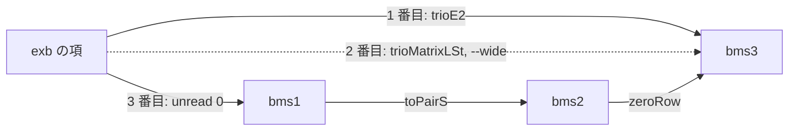

[← Back](README-ja.md) | [English](trans.md) | [Japanese](trans-ja.md)

# `trans` のルート

- 図のノードは表記（`trans` のシステム名）、矢印は写像です。
- A から B への変換では、矢印をつないだ経路をたどります。
- 実線の矢印は、書いてある範囲（定義域）で Lean が証明している写像です。
- 点線の矢印は、`--wide` を付けたときだけ使います。Lean では `#guard` で確かめただけで、証明はありません。

```mermaid
flowchart LR
  subgraph gD [DBMS]
    dbms1 -->|zeroRow| dbms2 -->|zeroRow| dbmsN
  end
  subgraph gB [BMS]
    bms1 -->|toPairS| bms2 -->|zeroRow| bms3 -->|zeroRow| bmsN
  end
  subgraph gO [順序数の項]
    exb
    ord
  end
  subgraph gS [数列]
    ssoss
  end
  subgraph gP [プログラム]
    por1
    wilken1
    por2
    wilken2
  end
  subgraph gN [まだ写像がない]
    inacc
    y
    omegay
  end

  dbms1 <-->|同じリスト| bms1
  bms1 -->|read 0| exb
  exb -->|unread 0: e0 未満| bms1
  bms2 -->|pairOrdTerm| exb
  ssoss -->|o: (0,0,2) 未満| exb
  exb -->|trioE2: p0 W_a, a は W 未満, 添字は 0 か 1| bms3
  exb -.->|trioMatrixLSt: p0 W_a| bms3
  ord -.->|trioRuleMatrixSt: ラベル a| bms3
  bms2 -->|phi.py| por1
  bms2 -->|tr.py| wilken1
  bms3 -->|phi3def2.py| por2
  bms3 -->|tr3.py| wilken2
```

矢印のラベルの意味:

| 矢印 | Lean | 受け付ける入力 |
|---|---|---|
| `zeroRow`、`toPairS` | `Googology/Trans/BMS/BMS/ZeroRow.lean:38`、`Googology/Trans/DBMS/DBMS/ZeroRow.lean:168` | どの行列でも |
| 同じリスト | `l1ToPrim`、`primToL1`、`Googology/Trans/DBMS/BMS/OneRowL.lean:113`、`:116` | 1 行の行列ならどれでも |
| `read 0` | `Googology/Trans/BMS/ExBuchholz/Basic.lean:49` | 標準形の 1 行の行列 |
| `unread 0` | `Googology/Trans/BMS/ExBuchholz/Basic.lean:197` | 添字がすべて 0 の標準形（e0 未満） |
| `pairOrdTerm` | `Googology/Trans/BMS/ExBuchholz/PSS/Rank.lean:344` | ペア数列。確かめるのは次の 2 つだけ: 最初の列が (0,0)、値が `p0(W_w)` 未満の標準形 |
| `trioE2` | `Googology/Trans/ExBuchholz/BMS/Trio/TrioFixStripTree.lean:113` | `p0(W_a)` の形。`a` は標準形、`0 < a < W`、`a` の添字はすべて 0 か 1 |
| `trioMatrixLSt` | `Googology/Trans/ExBuchholz/BMS/Trio/TrioFixStrip.lean:422` | `p0(W_a)` の形。`--wide` のときだけ |
| `trioRuleMatrixSt` | `Googology/Trans/ExBuchholz/BMS/Trio/TrioFixStrip.lean:410` | シートのラベル `a`。`p0(W_a)` として読む。`--wide` のときだけ |
| `o` | `Googology/Notation/SSOSS/SequenceOrdinal.lean:17` | 強2階探索数列。成分が 0 か 1 で、長さ 2 以上なら (0,0) で始まる |
| `phi.py`、`tr.py`、`phi3def2.py`、`tr3.py` | `Googology/Trans/BMS/PoR/` | プログラムのとおり |

`bmsN` と `dbmsN` は、どの行数でもよいことを表します。`zeroRow` は、どの `N` でも `N` 行から `N+1` 行へ移します。

## 経路の選び方

A から B への経路は、次の順に試します。

1. 短い経路から先に試します。
2. 長さが同じなら、点線の矢印が少ない経路を先に試します。それも同じなら、行列だけを通る経路（`zeroRow`）を先に試します。

- 経路上のすべての矢印が入力を受け付けた、最初の経路の結果を出します。
- どれかの矢印が入力を拒んだら、次の経路を試します。
- `--path` を付けると、使った経路を stderr に出します。

例えば、`exb` → `bms3` には経路が 3 つあります。`w+1` は `p0(W_a)` の形ではないので、1 番目と 2 番目の経路では拒まれます。



## 例

下の表の経路は、`--path` が出したものです。

| 入力 | 向き | 経路 | 出力 |
|---|---|---|---|
| `(0,0)(1,0)(2,0)` | `pss` → `prim` | `pairOrdTerm`、`unread 0` | `(0)(1)(2)` |
| `0,1` | `dbms1` → `exb` | 同じリスト、`read 0` | `w` |
| `w+1` | `exb` → `dbms3` | `unread 0`、同じリスト、`zeroRow`、`zeroRow` | `(0,0,0)(1,0,0)(0,0,0)` |
| `(0,0)(1,1)` | `pss` → `trio` | `zeroRow` | `(0,0,0)(1,1,0)` |
| `0,1` | `prim` → `por2` | `toPairS`、`zeroRow`、`phi3def2.py` | `0 a *n0` |
| `e0` | `exb` → `wilken2` | `trioE2`、`tr3.py` | `t0(W)` |
