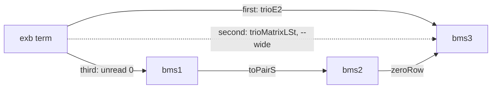

[← Back](README.md) | [English](trans.md) | [Japanese](trans-ja.md)

# The routes of `trans`

Each node is a notation (a system name of `trans`), and each arrow is a map.
A conversion from A to B follows a path of arrows. Solid arrows are maps that
Lean proves on the stated domain. Dashed arrows are used only with `--wide`:
Lean checks them by `#guard` only. The dashed arrow `o?` is used only with
`--candidate`: it is a conjecture, **not proved** and not in Lean.

```mermaid
flowchart LR
  subgraph gD [DBMS]
    dbms1 -->|zeroRow| dbms2 -->|zeroRow| dbmsN
  end
  subgraph gB [BMS]
    bms1 -->|toPairS| bms2 -->|zeroRow| bms3 -->|zeroRow| bmsN
  end
  subgraph gO [ordinal terms]
    exb
    ord
  end
  subgraph gS [sequences]
    ssoss
  end
  subgraph gP [programs]
    por1
    wilken1
    por2
    wilken2
  end
  subgraph gN [no map yet]
    inacc
    y
    omegay
  end

  dbms1 <-->|same list| bms1
  bms1 -->|read 0| exb
  exb -->|unread 0: below e0| bms1
  bms2 -->|pairOrdTerm| exb
  ssoss -->|o: below (0,0,2)| exb
  ssoss -.->|o?: candidate, not proved| exb
  exb -->|trioE2: p0 W_a, a below W, subscripts 0 or 1| bms3
  exb -.->|trioMatrixLSt: p0 W_a| bms3
  ord -.->|trioRuleMatrixSt: label a| bms3
  bms2 -->|phi.py| por1
  bms2 -->|tr.py| wilken1
  bms3 -->|phi3def2.py| por2
  bms3 -->|tr3.py| wilken2
```

The labels of the arrows:

| arrow | Lean | accepts |
|---|---|---|
| `zeroRow`, `toPairS` | `Googology/Trans/BMS/BMS/ZeroRow.lean:38`, `Googology/Trans/DBMS/DBMS/ZeroRow.lean:168` | any matrix |
| same list | `l1ToPrim`, `primToL1`, `Googology/Trans/DBMS/BMS/OneRowL.lean:113`, `:116` | any one-row matrix |
| `read 0` | `Googology/Trans/BMS/ExBuchholz/Basic.lean:49` | standard one-row matrices |
| `unread 0` | `Googology/Trans/BMS/ExBuchholz/Basic.lean:197` | standard terms with every subscript 0, i.e. below ε₀ |
| `pairOrdTerm` | `Googology/Trans/BMS/ExBuchholz/PSS/Rank.lean:344` | pair sequences; first column (0,0) and value a standard term below `p0(W_w)` are checked |
| `trioE2` | `Googology/Trans/ExBuchholz/BMS/Trio/TrioFixStripTree.lean:113` | `p0(W_a)`, `a` standard, `0 < a < W`, every subscript of `a` 0 or 1 |
| `trioMatrixLSt` | `Googology/Trans/ExBuchholz/BMS/Trio/TrioFixStrip.lean:422` | `p0(W_a)`, `--wide` only |
| `trioRuleMatrixSt` | `Googology/Trans/ExBuchholz/BMS/Trio/TrioFixStrip.lean:410` | a sheet label `a`, read as `p0(W_a)`; `--wide` only |
| `o` | `Googology/Notation/SSOSS/SequenceOrdinal.lean:17` | strong second-order searching sequences; entries 0 or 1, and (0,0) first when the length is 2 or more |
| `o?` | none: a port of [ssosn](https://github.com/koteitan/ssosn) `work/token_value.py`, **not proved** | standard sequences `s` with `(0,0,2) ≤ s < (0,0,2,1,0,2,1,1)`; `--candidate` only ([README.md](README.md)) |
| `phi.py`, `tr.py`, `phi3def2.py`, `tr3.py` | `Googology/Trans/BMS/PoR/` | as the programs |

`bmsN` and `dbmsN` stand for every number of rows: `zeroRow` goes from `N`
rows to `N+1` rows for every `N`.

## How a path is chosen

The paths from A to B are tried in this order:

1. the shorter path first;
2. among paths of the same length, the one without `o?` first, then the one
   with fewer dashed arrows, then the one through matrices only (`zeroRow`).

The first path whose arrows all accept the input gives the result. An arrow
that refuses its input makes `trans` try the next path. With `--path`, the
path used is printed on stderr.

For example, `exb` → `bms3` has three paths. For `w+1`, the first two refuse
it, because `w+1` is not of the form `p0(W_a)`:



## Examples

The paths below are what `--path` prints.

| input | from → to | path | output |
|---|---|---|---|
| `(0,0)(1,0)(2,0)` | `pss` → `prim` | `pairOrdTerm`, `unread 0` | `(0)(1)(2)` |
| `0,1` | `dbms1` → `exb` | same list, `read 0` | `w` |
| `w+1` | `exb` → `dbms3` | `unread 0`, same list, `zeroRow`, `zeroRow` | `(0,0,0)(1,0,0)(0,0,0)` |
| `(0,0)(1,1)` | `pss` → `trio` | `zeroRow` | `(0,0,0)(1,1,0)` |
| `0,1` | `prim` → `por2` | `toPairS`, `zeroRow`, `phi3def2.py` | `0 a *n0` |
| `e0` | `exb` → `wilken2` | `trioE2`, `tr3.py` | `t0(W)` |
